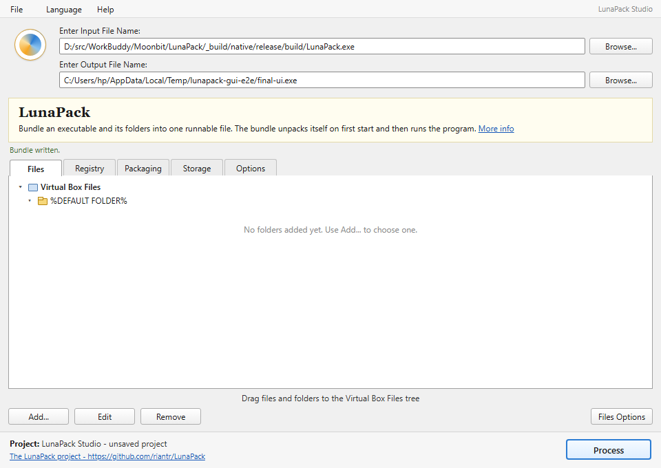
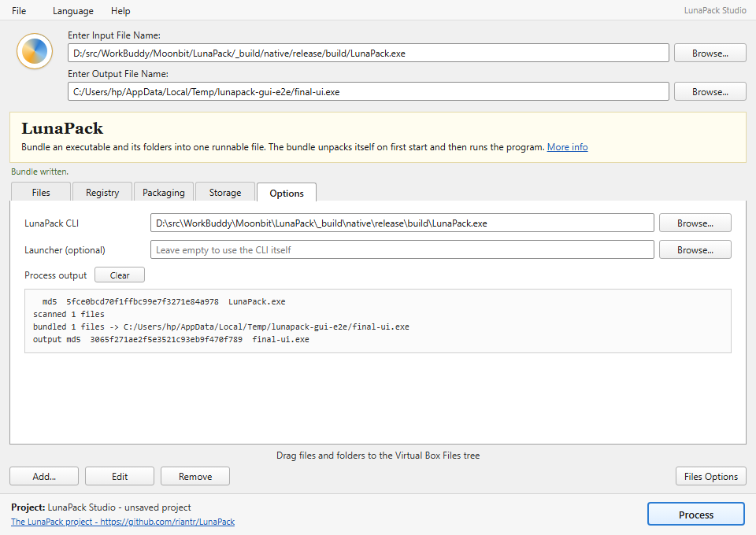

# LunaPack Studio

The graphical front end of [LunaPack](https://github.com/riantr/LunaPack),
built with `proton_cli` 0.9.1 and `moonbit-community/rabbita`. The frontend is
a Rabbita app served by Warren; the backend is a native Proton app that starts
the LunaPack CLI and returns its output to the window.

**LunaPack and LunaPack Studio are one product, not two packages.** Studio has
no version of its own and is not published to Mooncakes. It is an optional
asset of the LunaPack release, shares that release's version (`0.1.30` here),
and is downloaded on first use by `lunapack --GUI`. There is one tag and one
GitHub release for both.

The layout follows the classic Enigma Virtual Box style: an input/output file
pair, an information banner, a tab strip, a virtual-files tree, folder actions,
and a `Process` button. All example paths are generic; nothing from a
proprietary screenshot is baked in.




## Started by the CLI

```sh
lunapack --GUI
lunapack --GUI --input-file=./myapp.exe --output-file=./myapp-bundle.exe \
         --Files=./assets --Files=./docs --compression-method=lz4 \
         --name=demo --version=1.0.0 --os=windows --arch=x86_64
```

The CLI forwards the command line unchanged (minus the `--GUI` switch itself)
and appends `--cli=<its own executable>`. On startup Studio calls the
`startup_args` command, which parses every alias in both `--flag value` and
`--flag=value` form, then prefills the form:

| Flag | Fills |
|---|---|
| `--input-file` / `--input-exe` / `--input` / `-i` | Input file |
| `--output-file` / `--output-exe` / `--output` / `-o` | Output file |
| `--Files` / `--files` (repeatable) | Virtual Box Files folders |
| `--cli` | LunaPack CLI on the Options tab |
| `--launcher`, `--name`, `--version`, `--os`, `--arch` | Packaging / Options |
| `--compression-method` / `--compression` | Storage |
| `--virtual` / `--virtual-root` / `--virtual-temp` | Virtual tab |
| `--registry` | Virtual tab (the file's JSON is loaded into the seed editor) |
| `--runtime` | Virtual tab |
| `--no-virtual` | Turns the Virtual tab off, even if other layer flags follow |

Empty forwarded fields keep the window's defaults. An explicit `--cli` from
the launcher is never overwritten by auto-discovery. Unknown flags and
positional arguments are ignored, so a window always opens.

When no Studio is found beside the CLI or in the versioned cache, the CLI
streams `lunapack-studio-<os>-<arch>.zip` from the same release with a
progress bar and unpacks it in pure MoonBit. `LUNAPACK_STUDIO`,
`LUNAPACK_STUDIO_HOME` and `LUNAPACK_STUDIO_URL` override the lookup, the
cache and the source respectively.

## Stack

| Component | Version |
|---|---|
| `moonbit-community/proton_cli` | 0.9.1 |
| `moonbit-community/warren` | 0.4.5 |
| `moonbit-community/proton` | 0.9.1 |
| `moonbit-community/proton_contract` | 0.9.1 |
| `moonbit-community/proton_client` | 0.9.1 |
| `moonbit-community/proton_rabbita` | 0.9.1 |
| `moonbit-community/rabbita` | 0.16.4 |
| `moonbitlang/async` | 0.22.5 |
| LunaPack / Studio release | 0.1.30 |

Proton 0.9.1 requires lockstep versions. Do not mix a 0.8.x CLI with 0.9.1
modules: both the CLI and the modules use the cascade `..config(...)` form and
explicit `registrar.bind(...)` command bindings, and a version mismatch is
rejected before the window starts.

## Layout

- `shared/contract.mbt` — typed `Command` descriptors and JSON payloads used
  by both targets (`pick_path`, `scan_dir`, `probe_cli`, `run_pack`,
  `startup_args`).
- `frontend/main/main.mbt` — the Rabbita model, all views and the startup
  chain (`startup_args` -> `probe_cli` -> first folder scan), including the
  Virtual tab for the v7 layer; `frontend/public/styles.css` holds the light
  desktop styling.
- `backend/core/arguments.mbt` — pure `bundle` argument builder.
- `backend/core/startup.mbt` — pure startup-argument parser.
- `backend/logic/` — native command handlers: OS file dialogs, directory
  listing, CLI discovery, startup argv, and the subprocess that runs the pack.
- `backend/app/main.mbt` — assembles the Proton app (asset entry, config,
  single instance, command registration).
- `proton.project.json` — product identity, version, frontend dev/build.

Both pure packages are deliberately free of the Proton runtime so they can be
tested by a plain native test binary.

## Setup and run

```sh
moon update
moon install moonbit-community/warren@0.4.5
proton_cli setup          # CEF runtime + Proton subprocess (once)
proton_cli doctor         # expect 0 errors, 0 warnings

moon check --target js,native
proton_cli dev            # Warren dev server + native window
proton_cli build          # frontend/dist + native executable
proton_cli package --dry-run
proton_cli package --release
```

`dev` reads `proton.project.json`, starts Warren in `frontend/`, waits for
`http://127.0.0.1:4300`, then runs `backend/app`. `proton_cli dev -- <flags>`
passes flags to the app, which is a convenient way to test startup prefilling.

`proton_cli package --release` produces `dist/lunapack-studio.zip`. Rename it
to `lunapack-studio-windows-x86_64.zip` (matching
`studio_asset_name()` in the CLI) and attach it to the LunaPack release whose
version equals `moon.mod`; that is the asset `--GUI` downloads.

## How the Process button works

The GUI never assembles a shell command. It sends a `ProcessRequest` to the
backend, which builds an argument array and calls
`@process.collect_output_merged(cli, args, no_console_window=true)`. The exit
code and the merged stdout/stderr are returned to the window and shown on the
Options tab.

The backend starts the LunaPack executable itself rather than importing the
packing code: `bundle` appends the running executable to the archive as its
self-extracting launcher, so a GUI process is not a usable stub.

> **Flag compatibility note:** the `bundle` subcommand reads
> `--input` / `--output` (or `-i` / `-o`). The `--input-exe` /
> `--output-exe` / `--input-file` / `--output-file` spellings shown in
> LunaPack's usage text are accepted by its flag checker but are only read by
> the no-subcommand `moonx` front end. The GUI receives all of them from
> `--GUI` but emits `bundle --input <exe> --output <exe>`.

## Virtual layer

The **Virtual** tab edits the v7 layer that `bundle --virtual` writes. Turning
the layer on stores entries without compression: LunaPack refuses LZ4 and
encryption for a virtual bundle, so Studio emits `--compression-method none`
regardless of the Storage tab. A virtual bundle must use `lpvhost.exe` as its
launcher; Studio checks that the launcher field is set before calling the CLI.

| Field | CLI flag |
|---|---|
| Virtual layer | `--virtual` |
| Virtual root | `--virtual-root` |
| Virtual temp | `--virtual-temp` |
| Runtime image | `--runtime` |
| Registry seeds | temporary `--registry` file |

The seed editor holds the JSON the CLI's `--registry` reader accepts: either an
array of values or an object with a `values` array. Each value has `root`
(`hkcr`, `hkcu`, `hklm`), `key`, `name`, `kind` (`sz`, `expand_sz`, `dword`,
`binary`) and the matching `value`, `number` or `data`. The backend writes this
text next to the output as `<output>.lunapack-registry.json`, passes that path
to the CLI, and removes it after the process exits. An empty seed array is not
passed at all.

## CLI discovery

After startup arguments are applied, the frontend invokes `probe_cli`. The
backend checks, in order:

1. the `LUNAPACK_CLI` environment variable (must point to an existing file);
2. `../LunaPack/_build/native/release/build/LunaPack.exe`;
3. `../LunaPack/_build/native/debug/build/LunaPack.exe`;
4. `LunaPack.exe` on `PATH`.

The result is resolved to an absolute path with `@fs.realpath`, so it keeps
working when the working directory changes. A CLI path supplied by the
launcher as `--cli=` wins over all of these. You can also override it from the
**Options** tab, which is what you should do for a packaged app that no longer
sits next to the LunaPack checkout.

## Tests

```sh
moon -C backend test core --target native   # 15 tests (arguments + startup)
moon -C frontend test --target js           # 5 model tests
```

`backend/logic` links Proton's native runtime, so a plain `moon -C backend
test` cannot initialize outside a running Proton window. The pure logic is in
`backend/core` for exactly this reason.
